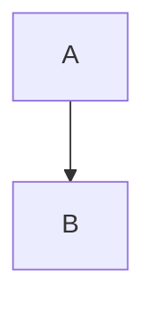

:::figure{src="/media/dustin-edwards-photo-fedcba9876543210-800x600.webp" alt="A described photograph" credit="Photo: Someone"}
A caption with *emphasis*.
:::

:::details{summary="Long methods"}
The details body, with a [link](https://example.com).
:::

:::sidenote{kind="Fallback"}
A note in the rail.
:::

A paragraph with a :pullquote[sentence worth raising] in it, and the colour :swatch[#6b4fbb] and :swatch[the brand]{color=#fff}.

:::chart{type="bar" x="label" y="value" alt="Two bars, a at one and b at two" title="Counts"}
```csv
label,value
a,1
b,2
```
:::

:::chart{type="line" x="year" y="a,b" labels="Alpha,Beta" alt="Two lines rising" title="Series"}
```csv
year,a,b
2020,1,2
2021,2,3
2022,3,5
```
:::

:::diagram{title="Flow" alt="Box A points to box B"}

:::
